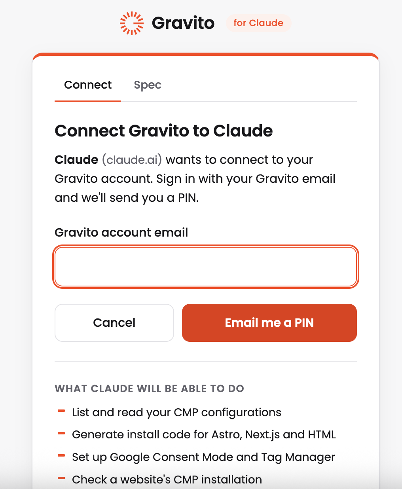
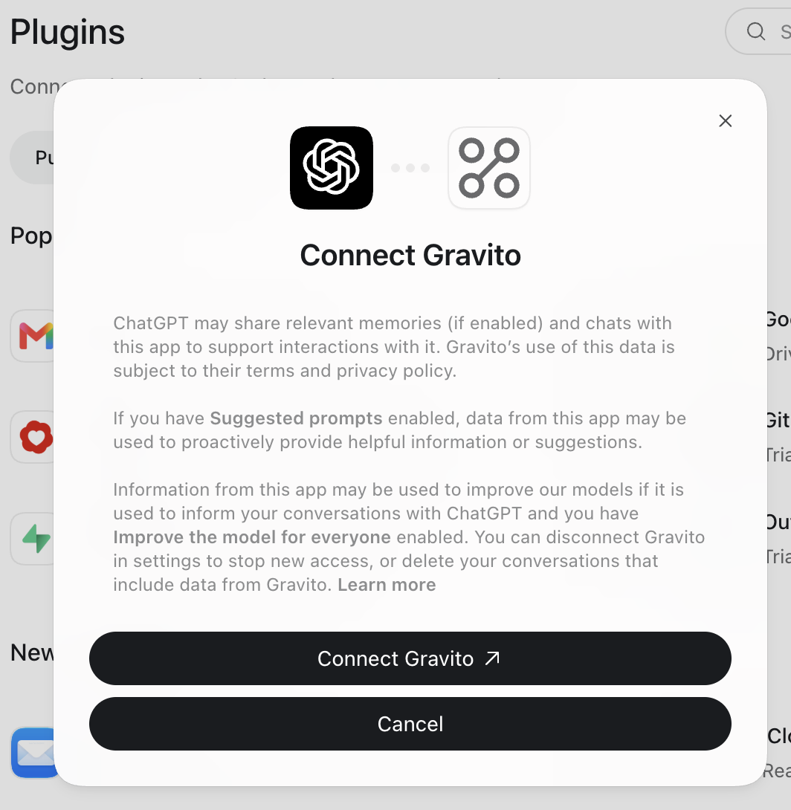
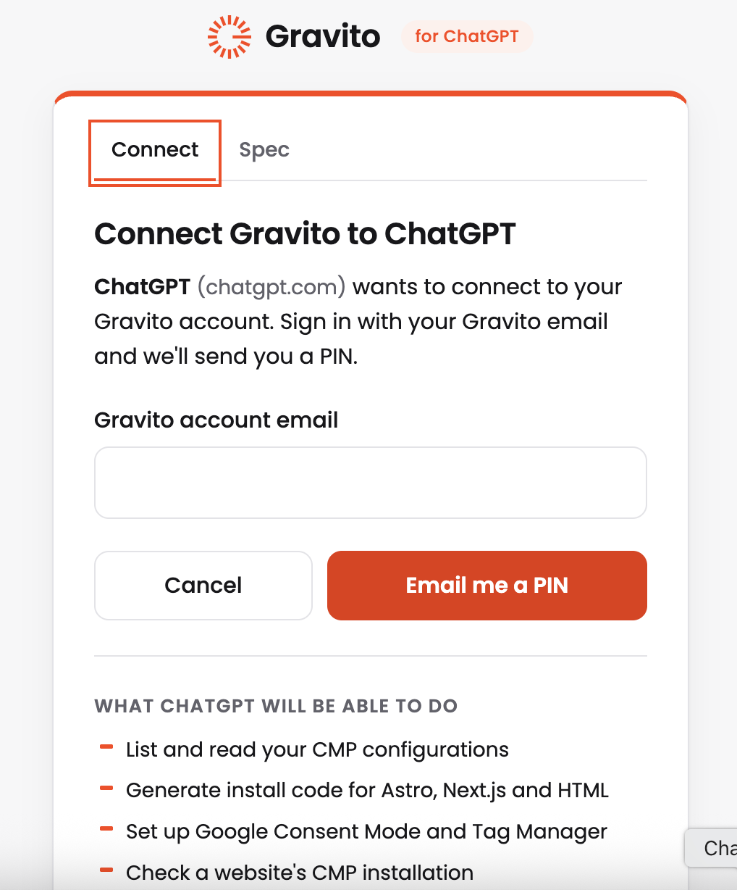
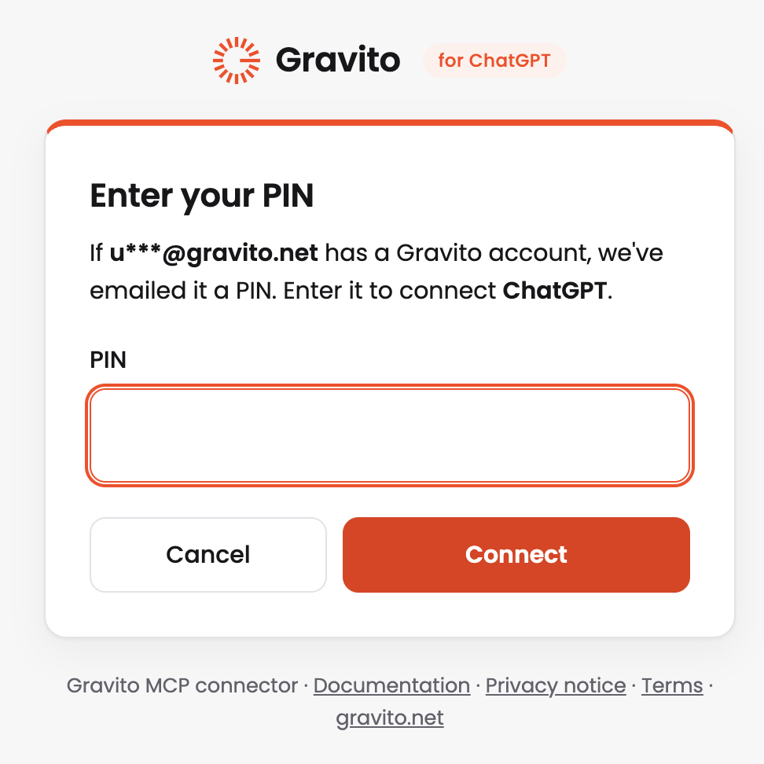

# Gravito MCP Connector

The Gravito MCP connector links your Gravito account to AI assistants that support the Model Context Protocol (MCP), such as Claude and ChatGPT. You can ask your assistant about your CMP configurations, get install code for your website or mobile app, check a live page, read your consent statistics, and draft a new banner.

It can't publish, delete or change anything that's live. Publishing always stays with a person in the Gravito portal.

***

## What you can do

| Area | What your assistant can do | Try asking |
| --- | --- | --- |
| Configurations | List and read your CMP configurations, Standard and TCF | "How many Gravito configs do I have, and which are TCF?" |
| Installation | Write install code for Astro, Next.js and HTML | "Add config 1234 to my Astro site" |
| Mobile apps | Give the WebView URL and setup for iOS, Android, React Native and Flutter apps | "How do I show config 1234 in my iOS app?" |
| Google | Set up Google Consent Mode and Tag Manager for Standard and TCF | "How do I set up GTM with config 1234?" |
| Site checks | Check whether Gravito is installed correctly on a page, and what loads before it | "Check the Gravito install on [www.example.com](https://www.example.com)" |
| Cookies | Read the cookie report for your domains | "Show the cookie report for example.com" |
| Statistics | Show accept and reject rates per domain | "Show consent stats for the last 30 days" |
| New banners | Draft a banner from an existing config, with a preview link | "Make a Finnish version of config 1234 with our green colours" |

***

## What it can't do

* Publish, restore or delete a configuration
* Change anything on a live website
* Read individual visitors' consent records
* Reach another customer's account
* Give legal advice or decide whether a setup is compliant

The connector reports how your setup is configured. It doesn't judge whether a setting is right, because that can depend on your own decisions. Different Google Consent Mode mappings can be valid, for example. Your assistant writes its own answers, so check anything important, and contact us if you're unsure:

* Google Consent Mode: [gcm.support@gravito.net](mailto:gcm.support@gravito.net)
* Anything else: [support@gravito.net](mailto:support@gravito.net)

***

## Before you start

You need:

* A Gravito account with a CMP configuration. If you're new, [register](../Getting_started/Register.md) first.
* Your website's domains added in the Gravito portal. Site checks, cookie reports and statistics work only on your registered domains and their subdomains.
* An AI assistant that supports remote MCP servers with OAuth sign-in.

Each login gives access to one Gravito customer account. Partner accounts with several customers aren't supported yet.

***

## Connect

Use the address `https://mcp.gravito.fi/mcp`. The sign-in page shows which app is connecting, and what it will be able to do.

### Claude (web, desktop or mobile)

1. Open **Customize** > **Connectors**.
2. Select **Add custom connector** and paste the address.
3. Select **Connect**. Gravito's sign-in page opens. Enter your Gravito account email and select **Email me a PIN**.

    

4. Enter the PIN we email you and select **Connect**.

On Team and Enterprise plans, an organisation Owner may need to add the connector first.

### Claude Code

```
claude mcp add --transport http --scope user gravito https://mcp.gravito.fi/mcp
```

Then run `/mcp` in Claude Code and sign in.

### ChatGPT

1. In ChatGPT's settings, add the address as a custom connector (an app), with OAuth sign-in. Depending on your plan, this may need developer mode turned on.
2. ChatGPT explains what it shares with the app. Select **Connect Gravito**.

    

3. Gravito's sign-in page opens. Enter your Gravito account email and select **Email me a PIN**.

    

4. Enter the PIN we email you and select **Connect**.

    

### Other assistants

Add the address as a custom connector or remote MCP server, using OAuth sign-in. We've tested Claude and ChatGPT. Support for others depends on how each one handles sign-in, so [contact support](../Getting_started/Support.md) if you'd like to use a different one.

### After an update

Assistants keep the list of tools they got when you connected. If a new feature doesn't appear, refresh or reconnect the connector in your assistant's settings, then start a new chat.

***

## Mobile apps

For an iOS, Android, React Native or Flutter app, your assistant gives you your configuration's **WebView source URL**, the same one shown in the portal's Deployment tab. It also tells you how to connect the app to the banner and what consent data the app must store, for both Standard and TCF.

The app loads the URL with two required parameters:

```
https://cdn.gravito.net/cmpconfigs/.../latest.html?platform=ios&region=<REGION>
```

The URL stays the same when you publish changes. For the full setup, see the [WebView integration guide](../Gravito_V6_CMP/FAQ/GPP-Support-webview.md) and [Deployment](../Gravito_V6_CMP/Deployment.md).

***

## Tools

| Tool | What it does | Access |
| --- | --- | --- |
| `list_cmp_configs` | Lists your configurations and their kind | Read |
| `get_cmp_config` | Summarises one configuration | Read |
| `list_templates` | Lists the portal's templates | Read |
| `get_install_snippet` | Returns install code for a website, or the WebView setup for a mobile app | Read |
| `get_consent_mode_snippet` | Returns the code for sites using Google tags | Read |
| `get_gtm_setup` | Explains the Google Tag Manager setup | Read |
| `validate_privacy_link` | Checks a privacy policy link | Read |
| `check_site_installation` | Checks the install on a public page | Read |
| `get_cookie_report` | Returns the cookie report for a domain | Read |
| `get_consent_stats` | Returns consent statistics per domain | Read |
| `list_cmp_drafts` | Lists your drafts and preview links | Read |
| `create_cmp_draft` | Creates a draft from a configuration | Draft |
| `update_cmp_draft` | Changes a draft | Draft |
| `save_draft_to_gravito` | Saves a draft to your account, unpublished | Draft |

Tools that change a draft or save one to your account are marked for confirmation, so assistants that support this ask you first. Claude does.

***

## Security and data

* **Sign-in:** OAuth with your Gravito email and a PIN. You never give your assistant a password or API key.
* **Access:** your assistant only sees the Gravito account you signed in with. You can disconnect it at any time.
* **Permissions:** the connector has two permissions, `cmp:read` and `cmp:draft`. Most assistants ask for both. An app that asks only for `cmp:read` can read but can't create or save drafts.
* **Statistics:** consent statistics are totals per domain, not individual visitors.
* **Drafts:** a draft stays with the connector for 30 days after its last change, unless you save it to Gravito.
* **Preview links:** anyone who has a preview link can open it until the draft expires, so share it with care. Previews aren't indexed by search engines, and clicks on them aren't counted in your statistics.
* **Logs:** Gravito keeps a 90-day log of which tools are used, with your email hashed. We don't store your conversations.

When you connect, what the tools return goes to your assistant, and its provider's terms cover your use of it. Read our [privacy notice](https://www.gravito.net/privacy-notice/) for how Gravito handles data.

***

## Troubleshooting

| What you see | What to do |
| --- | --- |
| "Too many PIN requests" | Wait 15 minutes and try again. |
| No PIN email | Check your spam folder, and that you used your Gravito account email. |
| "Partner accounts not supported yet" | Your login is linked to several customers, which isn't supported yet. Contact support. |
| "Isn't registered in your Gravito account" | Add the domain in the Gravito portal, then try again. |
| "Doesn't include draft access" | The app connected with read access only. Reconnect it and allow draft access (`cmp:draft`). |
| A new feature doesn't appear | Refresh or reconnect the connector in your assistant's settings, then start a new chat. |

***

## Moving from OneTrust

If your website uses OneTrust, your assistant can rebuild its banner in Gravito for you. For example: "Move www.example.com from OneTrust to Gravito".

Your domain must be registered in your Gravito account, and you need one Gravito configuration of the same kind, Standard or TCF.

1. Ask your assistant to scan your site. You get a report of your OneTrust setup: Standard or TCF, regions, categories, cookies, languages and vendors.
2. Ask it to import the site. You get a Gravito draft with a preview link.
3. Review the preview and the list of what carried over.
4. Ask it to save the draft to Gravito. It appears in the portal, unpublished.
5. Review and publish it in the portal.
6. Make the listed changes on your site and install Gravito.

**What carries over:** whether you use Standard or TCF, categories, banner texts in up to 12 languages, TCF purposes and vendors, colours, logo, banner position, button shape and order, and your Google Consent Mode mapping.

**What needs your attention:**

* Your other custom CSS. It's written for OneTrust's page structure, so your assistant can rewrite the parts you want to keep.
* A logo hosted by OneTrust. Upload it to Gravito before your contract ends.
* Google's Additional Consent vendors. They're imported, but check them in the portal.
* Script tags and Tag Manager triggers that depend on OneTrust. The report lists the ones it can see.
* Banners that differ by region. Each import covers one OneTrust rule.

Visitors will probably see the banner once more after you switch, because stored OneTrust consent doesn't carry over.

**Tools used for the move:**

| Tool | What it does | Access |
| --- | --- | --- |
| `scan_onetrust_site` | Reports on a registered site's OneTrust setup | Read |
| `import_onetrust_site` | Creates a draft from a site's OneTrust setup | Draft |

Saving the draft uses `save_draft_to_gravito`, described under [Tools](#tools).

**Troubleshooting:**

| What you see | What to do |
| --- | --- |
| "No OneTrust tag was found" or the site can't be read | Give your assistant your OneTrust id, the `data-domain-script` value in your OneTrust tag. |

Need help? Contact [Gravito support](../Getting_started/Support.md).
